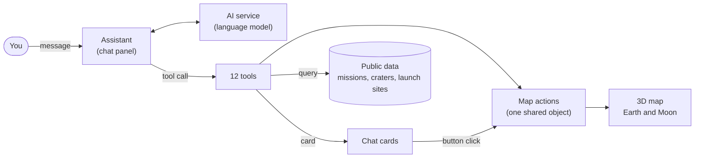
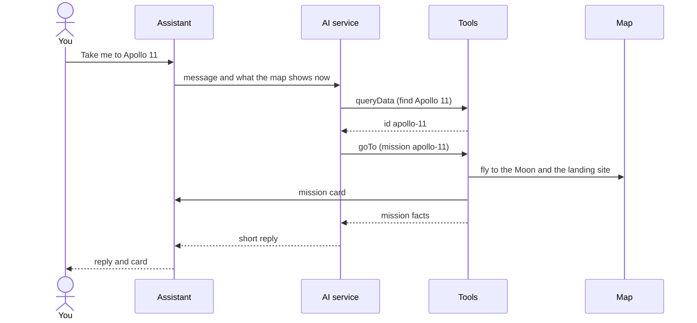

# Talk to the Moon

An AI assistant that drives a 3D map. Ask **"Take me to Apollo 11"** and it
finds the mission, flies the camera from Earth to the Moon, stands a lunar
module at the landing site, and shows a card in the chat.

It is a small example of an **agentic map**: a chat assistant that can only act
through a few typed tools over real data. The same pattern works on any map.

Built with Next.js, React, TypeScript, and the
[ArcGIS Maps SDK for JavaScript](https://developers.arcgis.com/javascript/latest/) 5.2.
There is no backend: the page is static, the data is public, and the language
model runs on the ArcGIS AI service you sign in to.

## Run it

You need Node.js 20.9+ and [pnpm](https://pnpm.io/).

```bash
pnpm install
pnpm dev
```

Open <http://localhost:3006>. The map works straight away. To chat, sign in
through the assistant panel with an ArcGIS account that has access to the AI
assistant service.

To use a portal other than <https://www.arcgis.com>, copy
[.env.example](./.env.example) to `.env.local` and set `NEXT_PUBLIC_PORTAL_URL`.

Best on a desktop browser with a wide window.

## Things to try

The assistant suggests these one at a time, or type your own:

| Prompt | What it shows |
| --- | --- |
| How many missions have been launched from each country? | A question answered with a table |
| Where did those missions land? | The trip from Earth to the Moon |
| Go to an Apollo mission | The assistant asks which one instead of guessing |
| Show the nearest crater | Real lunar distances |
| Place the tallest building on Earth inside it | An object at true scale |
| Let me fly the lander | An easter egg: arrow keys steer, Esc lands |

## How it works



1. You type a message.
2. The model picks a tool, for example `goTo`, and fills in its input.
3. The tool checks the input, looks up real data, and moves the map.
4. The tool sends a **card** to the chat and returns **facts** to the model.
5. The model writes a short reply from those facts.

"Take me to Apollo 11" in detail:



Two things keep the answers trustworthy:

- **Facts come only from tools.** The model never invents numbers; it explains
  what a tool returned.
- **Tools take exact ids, not free text.** If a request is unclear, the
  assistant asks you to choose.

## Find your way around the code

```text
app/                Next.js entry page
src/
  App.tsx           Page layout: two 3D scenes, time slider, assistant
  data.ts           Data layers, record types, lookups
  map/              The maps and everything that changes them
    controller.ts   The shared map actions (visit, select, frame, ...)
  agent/            The assistant: instructions, skills, tools
    tools/          The 12 tools, a few per file. Start with navigate.ts
  cards/            Chat cards and charts
  extras/           Optional: 3D lander model, flight easter egg
test/               Unit tests
docs/               Guides
backups/            CSV copies of the data layers
```

Read [App.tsx](./src/App.tsx), then [controller.ts](./src/map/controller.ts),
then [tools/navigate.ts](./src/agent/tools/navigate.ts). The
[build-your-own guide](./docs/build-your-own.md) follows one request through
these files and shows how to add a tool.

## Check your changes

```bash
pnpm test && pnpm check-types && pnpm lint && pnpm build
```

## Learn more

- [Build your own](./docs/build-your-own.md): follow a request and add a tool
- [Technical guide](./docs/technical-guide.md): architecture, every tool, and common questions
- [Reference](./docs/reference.md): configuration, data sources, and SDK caveats
- [Test prompts](./docs/test-prompts.md): prompts that cover every tool and card
- [Demo script](./docs/demo.md): a three-minute walkthrough

## Credits

- **Missions:** NASA NSSDCA, Table of Anthropogenic Impacts and Spacecraft on the Moon
- **Craters:** IAU/USGS Gazetteer of Planetary Nomenclature
- **Lander model:** NASA 3D Resources

Details are in the [reference](./docs/reference.md#data). This project is not
affiliated with or endorsed by NASA.

## AI-assisted development

This app was built with help from AI coding tools. The code and docs were
reviewed by a person, but mistakes may remain. Check anything you plan to rely
on, and please open an issue if you find a problem.

## License

[MIT](./LICENSE) for the code. The lander model and the data in `backups/` keep
their own terms.
