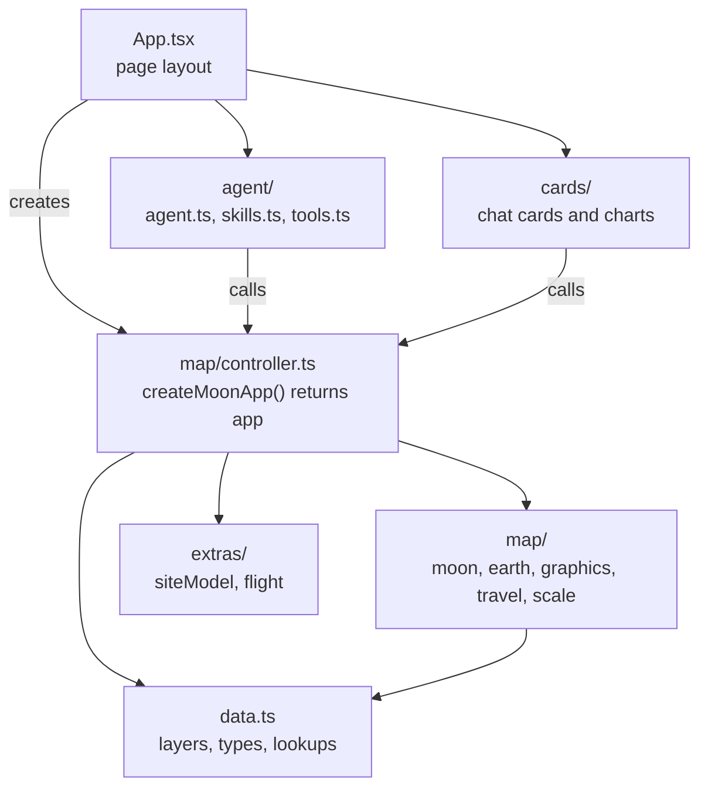

# Technical guide

How Talk to the Moon works. Read the [README](../README.md) first for the short
version. Configuration and data sources are in the [reference](./reference.md).

## Stack

| Part | What's used |
| --- | --- |
| Framework | Next.js 16 (App Router), React 19, TypeScript. The page renders in the browser only, because the SDK needs it |
| Map | `@arcgis/core` and `@arcgis/map-components` 5.2: two `arcgis-scene` elements (Moon and Earth), `arcgis-time-slider`, legend, popups |
| AI | `@arcgis/ai-components`: `arcgis-assistant` (chat and sign-in), `SkillAgent`, `FunctionTool` |
| Charts | `@arcgis/charts-components`: `arcgis-chart` |
| UI | Calcite components |
| Validation | A Zod schema for every tool's input |

There is no backend. The data comes from public ArcGIS Online feature layers,
and the language model runs on the AI service of the portal you sign in to. The
app does not choose or host the model.

## Architecture

One object, `app`, holds every map action. The agent's tools and the buttons on
chat cards both call it, so clicking a mission and asking for it do the same
thing.

## Startup

1. [config.ts](../src/config.ts) sets the portal URL before any component
   loads, because the assistant reads it when it loads.
   [register.ts](../src/register.ts) imports only the components the app uses.
2. [App.tsx](../src/App.tsx) creates both maps once and passes them to the two
   `arcgis-scene` elements.
3. `createMoonApp()` loads four things in parallel: the mission and launch-site
   records, both views, the crater layer's schema, and the geodetic operators.
4. It sets up the mission symbols, the stars and lighting, the time slider, and
   the travel between worlds.
5. When `app` is ready, React renders the agent and the chat cards.

## A request, step by step

"Take me to Apollo 11":

1. The assistant sends the model your message, the agent's instructions and
   skills, and a description of what the map shows right now.
2. The agent picks the `explore` skill. A skill limits which tools may be used.
3. The model calls `queryData` with `name = 'Apollo 11'`. The tool queries the
   hosted layer and returns the id `apollo-11`.
4. The model calls `goTo` with `{ kind: "mission", id: "apollo-11" }`. The tool:
   - checks the input against its schema,
   - sends a mission card to the chat,
   - starts `app.visit()`, which travels to the Moon, selects the mission, flies
     in, and stands the lunar module at the site,
   - returns the mission's facts to the model as JSON.
5. The model writes a short reply from those facts.
6. [Cards.tsx](../src/cards/Cards.tsx) renders the card in the chat.

A tool returns two things: a card for the user and facts for the model. The
model does not draw the UI.

## The agent

`SkillAgent` takes a system prompt, instructions, skills, tools, and a function
that describes the current map. A skill is a block of Markdown with guidance
and a list of allowed tools.

| Skill | For | Tools |
| --- | --- | --- |
| explore | Finding and visiting missions, craters, places, launch sites | queryData, goTo, showMissions, chooseMission, showCraters, nearestCraters, showCraterNames, clearMap, showChart, flyLander |
| history | Chronology, gaps, trends, the time slider, charts | queryData, setTime, showMissions, goTo, chooseMission, showChart |
| scale | True-scale objects compared with craters | queryData, placeObject, goTo, chooseMission, clearMap |

### Tools

| Tool | What it does |
| --- | --- |
| `queryData` | Read-only SQL on missions or craters: `where`, fields, statistics, group by, order by, up to 1,000 rows. Shows a table only when the numbers are the answer |
| `goTo` | Moves the camera to a mission, crater, place, launch site, the Moon, or Earth. Travels between worlds when needed |
| `showMissions` | Shows a set of missions and hides the rest, with a list card. With no arguments it restores everything |
| `chooseMission` | Pauses and asks the user to pick, for example "Which Chang'e?" |
| `showCraters` | Marks craters by exact name, with their rims |
| `nearestCraters` | Ranks craters by lunar surface distance from a mission, crater, or place |
| `showCraterNames` | Shows or hides all crater labels |
| `setTime` | Sets the slider to the end of a year, or pauses it |
| `showChart` | One of 3 preset charts, or a custom bar, line, pie, or scatter chart |
| `placeObject` | Stands a real object at true scale, drawn as one of 5 simple shapes |
| `clearMap` | Removes drawings and selections |
| `flyLander` | Easter egg: fly a lunar module with the arrow keys |

### How it avoids making things up

- Facts come only from tools. The instructions forbid estimating numbers,
  reading values off charts, or counting from cut-off results.
- Actions take exact ids or names that the model first gets from `queryData`.
  There is no fuzzy matching. An unknown id returns an error the model can read.
- The tool descriptions list the exact values in the data (countries,
  operators, launch-site ids), so the model does not guess them.
- Tool errors go back to the model. Without the `returnErrors` wrapper in
  [tools.ts](../src/agent/tools.ts), SDK 5.2 ends the request with "I couldn't
  complete this request."
- Before each turn the model is told which world is showing, the slider dates,
  the selection, the last place the camera went, and what is drawn. This is how
  "tell me more about it" works.
- The instructions state what the data does not cover: crater depths, features
  that are not craters, and launches that never reached the surface.

## Data

| Layer | Records | Source | How it's used |
| --- | --- | --- | --- |
| Missions | 51 | NASA NSSDCA | Read once at startup into memory; also queried with SQL |
| Craters | 1,575 | IAU/USGS gazetteer | Queried from the service when needed |
| Launch sites | 10 | Curated | Read once at startup |

Mission outcomes are `crewed`, `soft` (robotic landing), `crash`, and `impact`
(planned impact). 28 of the 51 are successful landings. CSV copies are in
`backups/`.

## The map

### The Moon is drawn on an Earth-sized globe

The Moon's imagery and elevation services are published in Web Mercator, so the
scene draws the Moon at Earth's size. [scale.ts](../src/map/scale.ts) is the only
file that deals with this. `sceneMeters()` multiplies real lunar meters by about
3.67 (Earth's radius divided by the Moon's) for symbol sizes, heights, and
camera distances.

Distances are still real lunar distances. They use the SDK's geodetic operators
in the Moon's own coordinate system, GCS_Moon_2000 (wkid 104903).

SceneView can use a Moon coordinate system directly, as an experimental feature,
but that needs imagery and elevation services published in it.

### Symbols

- Mission icons are a `PointSymbol3D` with two icon layers: a disc for the
  outcome and a country flag on its corner. The icon floats above the site on a
  thin line, so it never sinks into a crater wall.
- A `UniqueValueRenderer` on `country` and `outcome` picks the icon.
- Selecting uses `layerView.highlight()`, labels for up to 6 missions, and a
  `FeatureFilter` to hide the rest.

### Time slider

The `arcgis-time-slider` takes its range from the mission layer's `timeInfo`. It
is cumulative, with a stop every 2 months.

### Travel between Earth and the Moon

Both scenes are loaded all the time and stacked on top of each other. A trip:

1. The departing camera pulls back and arcs 35° around the globe.
2. The globe slides toward a corner. This animates the view's `padding`, which
   moves the 3D content but not the widgets.
3. The scenes crossfade with CSS opacity.
4. The other globe slides in from the opposite corner and the camera flies in.

After a close-up the camera orbits 30° over 9 seconds. Any user input stops it.
The app respects the "reduce motion" setting throughout.

### Drawings and extras

- Crater rims are geodesic circles from the recorded diameter.
- True-scale objects are SDK primitives (cylinder, cone, cube, sphere). You can
  drag them; the label follows.
- The lunar module at a visited site is a glTF model sized to the camera
  distance. It hides when you zoom out.
- The flight easter egg moves the lander each animation frame and keeps a
  camera behind it.

## Charts

- Crater charts read the hosted crater layer directly.
- Mission charts read a client-side `FeatureLayer` built once from the loaded
  records. It keeps the hosted field names, adds derived fields (`side`,
  `daysToSurface`, decades), and uses coded-value domains so axes show
  "Crewed landing" instead of `crewed`.
- A custom chart is checked against the available fields, and its SQL is tested
  with a count query, before the card is shown.

## Security and cost

- The model sees the tool descriptions, your messages, the map description, and
  the rows its queries return. It does not see credentials.
- It can only call the 12 tools. Every input is checked by a Zod schema.
- SQL `where` clauses go to the query endpoint of public, read-only layers. The
  worst case is a failed read. There are no tools that write data.
- The app holds no secrets. Sign-in is OAuth with the portal, handled by
  `arcgis-assistant`.
- Hosting is static. AI usage is billed through the portal's AI service.

## Known limits

- Built for desktop. Two 3D scenes and a chat panel need a wide screen.
- The data covers only missions that reached the surface, and only named
  craters. Crater depths are not included.
- Point-to-point measurements between two arbitrary places are not supported.
- The legend ignores the flag's position, so swatches show the flag over the
  disc. The map itself is correct.
- SDK workarounds are listed in the [reference](./reference.md#sdk-caveats-52).

## Common questions

**Is it scripted?**
No. Nothing maps questions to actions. The model picks tools from their
descriptions.

**Which model is it?**
Whichever one the portal's AI service provides.

**Can it change or delete data?**
No. Every data tool is read-only, and so are the layers.

**How does it know the Burj Khalifa's height?**
From the model's general knowledge, and the card says so. The crater's diameter
comes from the IAU data.

**Why two scenes instead of one?**
Earth and the Moon have different imagery, terrain, and scale. Keeping both
loaded makes the trip instant.

**Would this work on my data?**
Yes. You need a scene, an assistant, and tools over your layers. The
Moon-specific code is mostly `scale.ts` and the travel animation. See
[Build your own](./build-your-own.md).
